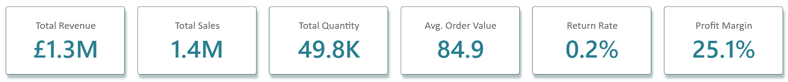
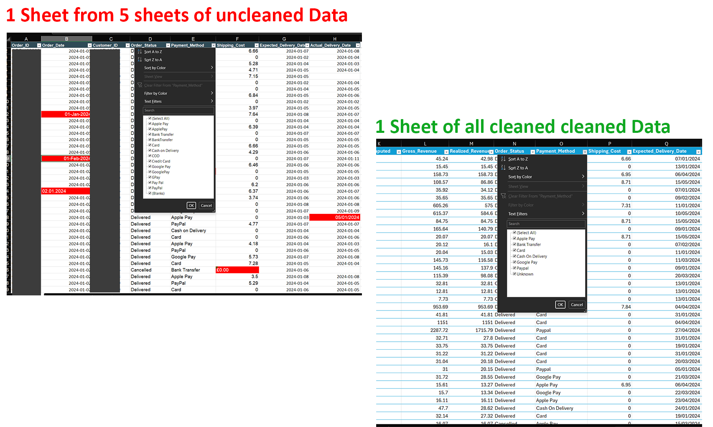
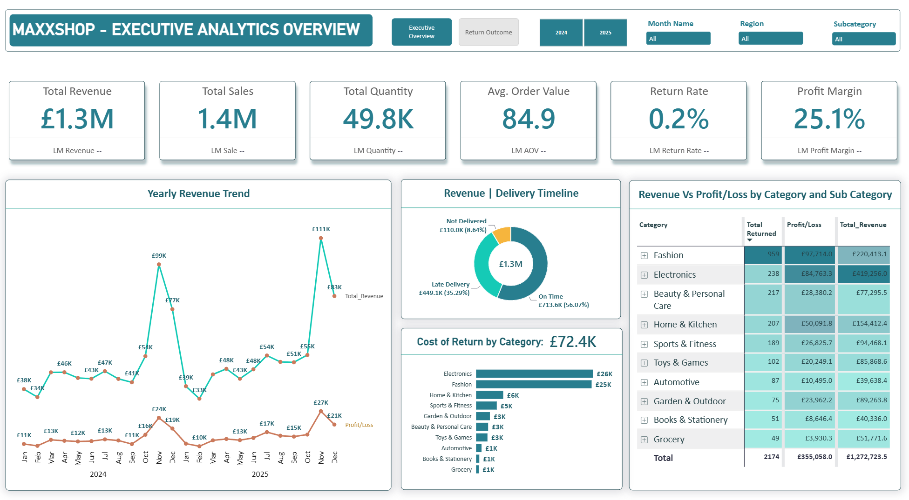
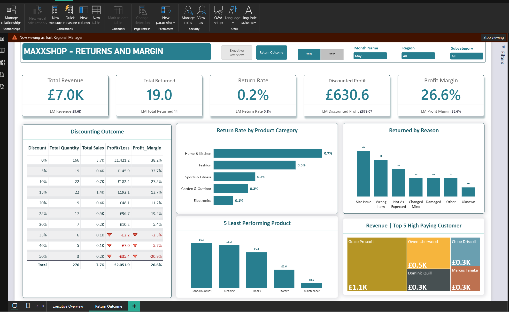

# Overview

MaxxShop is an online retailer selling over 300 products across 10 categories through its website and app. It serves five regions and three customer segments: New, Returning and Premium members, offering multiple payment and delivery options.
The business competes through low prices, wide product choice and year-round discounts, with increased promotions during November and December. Between January 2024 and December 2025, MaxxShop processed approximately 15,000 orders from 4,200 customers and also show the row level security between regions.

## Problem Statement

MaxxShop’s problem comes from three things happening at once. 
- Discounts are set by the manager of each product group, and those managers are judged on sales, not on the profit the discounts give away. 
- Nobody has ever added up what discounts and returns really cost, even though some items are cut in price a lot and sent back often. 
- Nobody checks if orders arrive by the promised date, so late deliveries may be causing returns and losing customers in some regions. 
Together, these make it hard to grow sales and still make money.

## Aim

The Aim is to study the company’s order, product and customer data to find out where the money is being lost, spot the weak areas across product groups, regions and types of customers, and say what should be done about them so MaxxShop stops losing profit.

## Tooling

Excel and Power Bi

## Data Cleaning in Excel

The data was cleaned in Excel using functions and tools such as **PROPER(), TRIM(), FIND & REPLACE, REMOVE DUPLICATES, MEDIAN(),** Using inbuilt tools to fix the date.
Also Look up functions like **XLOOKUP, and INDEX-MATCH** were used to get columns from different sheets.

## Data Transformation and DAX Development

This data was modelled and transformed in Power BI using a Star Schema, with 5 Dimension Tables **(Product, Customer, Oder_item, Order and Calender)** connected to a central Fact Table.
Power Query (M Language) was used to create and structure additional tables like **Delivery_Date_Segment**.

 Calendar Table was created using DAX, covering the order date range and linked to the Fact table with DATE to **ORDER DATE** (start and end dates).

30 DAX measures were developed, incorporating functions such as **DIVIDE(), AVERAGE(), CALCULATE(), and SUMX(),SUM() and DISTINCTCOUNT()** to support the analysis and generate actionable insights.

### Key Question & Answers

1. Build a monthly revenue and profit trend across both years and point out which is seasonal.
2. Which categories and subcategories generate the most revenue and The most profit?
3. What did Return cost us?
4. Is our promises to deliver products on time met?
5. How does discounting rate impact our profit?
6. what are the highest reasons for product returns?
7. Are there products or subcategories that are less profitable to us?
8. What are the top customers that generate us the highest revenue?
9. Include a Row Level Security for all regions

 

 

**Key Insights**

- Revenue and profit spike every November (£99K to £111K revenue; £24K to £27K profit), indicating seasonal demand, with a steady baseline in other months
- Electronics drives the most revenue (£419K, 33%), yet Fashion is the most profitable (£97.7K) on half the sales.
- Returns cost £72.4K over 2024-2025, driven mainly by Electronics (£25.8K) and Fashion (£25.5K).
- On time delivery time not fairly met: just 56% of orders were delivered on time, 35% late, and 9% not delivered.

 

**Key Insights**

- Discounts must be capped at 35% to protect margins; rates at or above 40% yield net losses.
- The highest reason for return is Size Issue and that is associated with fashion.
- 5 Least profitable sub-categories: Maintenance (£2.5K), School Supplies (£2.4K), Household Essentials (£1.6K), Snacks (£1.3K), Beverages (£1.1K).
- Grace Costa is the highest-paying customer (£6.17K), closely followed by Callum Yilmaz (£6.07K).

## Row Level Security

Row Level Security for May 2025 in action. Dashboard filtered to East region only using the Regional Manager role. Total revenue restricted to £7K and Last Month Revenue to £9.6K,demonstrating RLS working correctly across all visuals.

## Recommendations
**Action Plan**
1. Boost advertising and cross-promotion before the November-December peak to acquire new customers.
2. •	Renegotiate supplier terms or pricing on Grocery, which has the lowest margin.   •	Invest more in Fashion, which delivers the highest profit (£97.7K) and margin (44%)..
3. Add secure delivery for Electronics and size guides for Fashion to reduce returns
4. Review courier performance and replace underperforming providers to reduce late and failed deliveries
5. Cap discounts at 35%, since 40%+ discounts cause losses.
6. Provide or improve online size guides to reduce size-related returns, the top return reason.
7. Review the 5 least profitable sub-categories and discontinue consistently weak lines, replacing them with higher-margin alternatives.
8. Launch a tiered loyalty programme that encourages mid-tier customers to increase spending toward top-customer levels.
