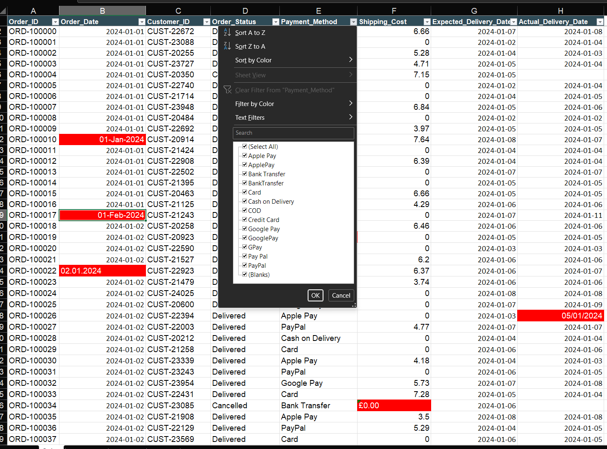
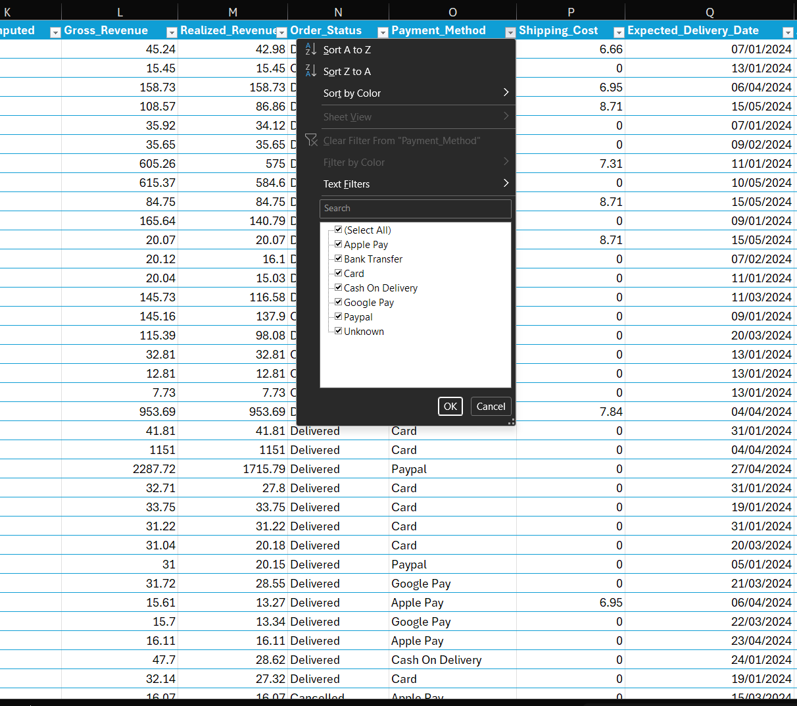

# Overview

MaxxShop is an online retailer selling over 300 products across 10 categories through its website and app. It serves five regions and three customer segments: New, Returning and Premium members, offering multiple payment and delivery options.
The business competes through low prices, wide product choice and year-round discounts, with increased promotions during November and December. Between January 2024 and December 2025, Shopora processed approximately 15,000 orders from 4,200 customers and also show the row level security between regions.

## Problem Statement

MaxxShop’s problem comes from three things happening at once. 
- Discounts are set by the manager of each product group, and those managers are judged on sales, not on the profit the discounts give away. 
- Nobody has ever added up what discounts and returns really cost, even though some items are cut in price a lot and sent back often. 
- Nobody checks if orders arrive by the promised date, so late deliveries may be causing returns and losing customers in some regions. 
Together, these make it hard to grow sales and still make money.

## Aim

The Aim is to study the company’s order, product and customer data to find out where the money is being lost, spot the weak areas across product groups, regions and types of customers, and say what should be done about them so MaxxShop stops losing profit.

## Tooling

Excel and Power Bi

## Data Cleaning in Excel

The data was cleaned in Excel using functions and tools such as PROPER(), TRIM(), FIND & REPLACE, REMOVE DUPLICATES, MEDIAN(), Using inbuilt tools to fix the date.
Also Look up functions like XLOOKUP, and INDEX-MATCH were used to get columns from different sheets.

<table align="left">
  <tr>
    <th align="left">Uncleaned</th>
    <th align="left">Cleaned</th>
  </tr>
  <tr>
    <td align="center">
      
    </td>
    <td align="center">
      
    </td>
  </tr>
</table>

## Analytical Approach
The dashboard is structured into two key analytical layers, each designed to answer specific business questions within the company.

### 1. Customer Analytics

This section focuses on understanding customer behavior and profitability.
**Key Metrics**
- Total Revenue: **14.74M**
- Total Profit: **1.52M**
- Total Orders: **5496**
- Total Customers: **1795**
- Profit Margin: **10.33%**

**Analysis Performed**
- Which customer segments generated the highest profit?
- How does profit vary across different customer segments and regions?
- Which 5 customers are responsible for the largest purchases?
- Based on the subcategory, how do they each contribute to profitability?

**Key Insights**
- Profit is concentrated among a small group of high-value customers, including Emily Phan (34.01K), Deborah Brumfield (31.12K), and Grant Carroll (27.98K). If these customers cut back or stop buying, the impact on results could be significant.

- Subcategory insight reveals key performers such as binders, paper, and furnishings, while the copier category operates at a loss of -16K, suggesting pricing issues, warranty expense, or high logistics overhead.

- By segment, Corporate contributes the most profit at 527.1K, while Home Office, Consumer, and Small Business together make up a substantial share. This confirms that Deskify serves both B2B and B2C markets. Geographic performance is similarly uneven: the Northwest leads at 569,398, while Yukon and Quebec remain significantly underdeveloped.

- These patterns point to clear growth opportunities through targeted marketing, regional penetration strategies, and customer loyalty initiatives. Refining segmentation, reducing reliance on top contributors, and activating weaker markets would diversify revenue and strengthen long-term, customer-driven profitability.

### 2. Product Analytics
This section focuses on the product performance.

**Analysis Performed**
- What are the top 10 states based on Deskify's profitability?
- Which product categories contributed the most to profitability?
- How does the choice of shipping method impact the number of orders?
- Which 5 products are the most profitable for Deskify?
- How has *Deskify's* profit evolved over time?

**Key Insights**
- Deskify’s product performance shows strong revenue contribution from certain categories, with **Office Supplies** generating the majority of total profit at **985.36K (64.73%)**, followed by Furniture at **331.03K** and Technology at **205.95K**.

- Top individual products including **Eldon ClusterMat and Panasonic** models highlight a dependency on a small set of profitable SKUs, creating product concentration risk.

- Operational data further indicates significant shipping cost pressure due to reliance on **air freight (nearly 90% of orders)**, which likely diminishes margins and limits scale efficiency.

- Seasonal trends reveal noticeable fluctuations in monthly performance, with **October (177K) and January (161K)** as the highest-earning months, and **August (81K)** the weakest. These fluctuations likely correlate with procurement cycles, budgeting periods, and business purchasing behaviors rather than consumer-driven trends. 

**Recommendation**

- Regular Air handles 74.11% of orders, creating over-reliance on one shipping method. Renegotiate carrier rates and shift non-urgent deliveries to Delivery Truck to reduce costs and minimise operational risks.
- Allocate more marketing spend and inventory to Office Supplies, which contributes 65% of category profit (985K), while maintaining Furniture’s profitability (22%) and exploring ways to improve Technology (14%).
- Discontinue the loss-making Copiers sub-category as it makes loss every year.
- Shift marketing and inventory budget away from the bottom performers like Machines, Fasteners and Copiers toward the two clear winners Binders, Paper and Furnishings.
- Don’t over rely on your top 3 named customers. Diversify the customer base like setting a concentration target and growing the mid-tier

